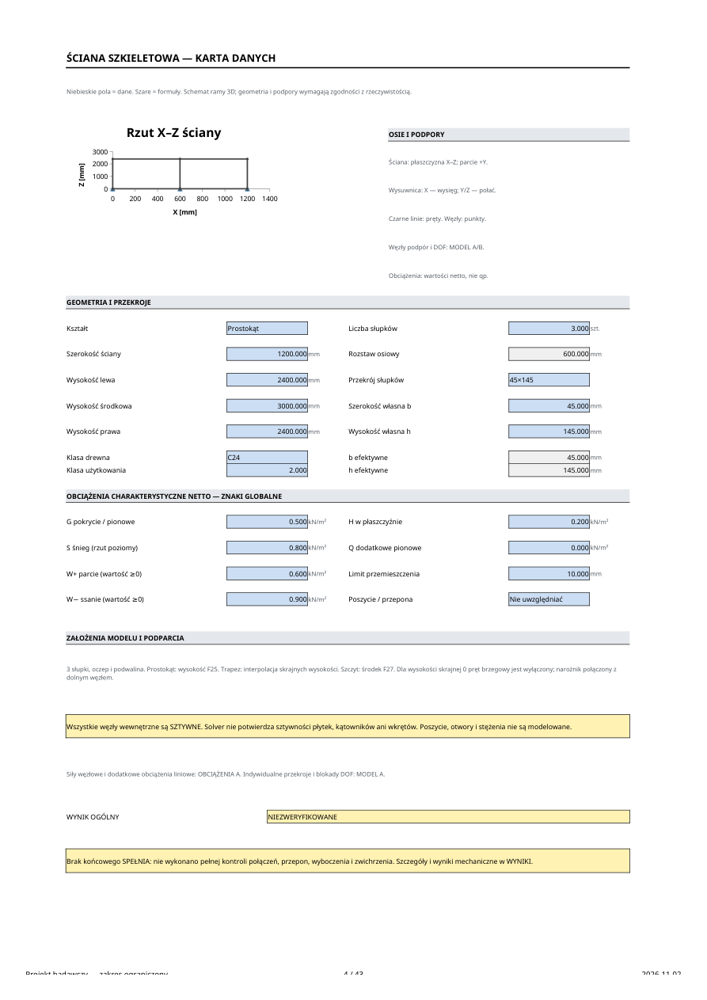
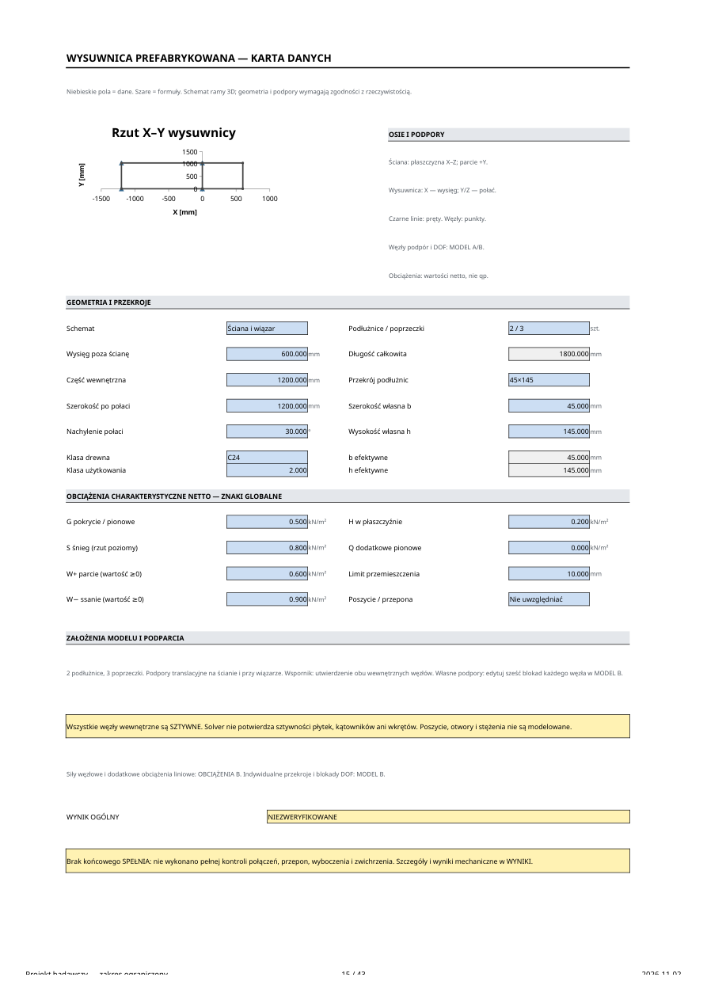

# Kalkulator ścian i wysuwnic — Excel

**Aktualny plan: oryginalny wygląd Gable panel stud, adaptacja PL.** [Pobierz poprawiony Excel v2](output/Gable_panel_stud_PL_v2.xlsx) · [zakres i źródła](gable_pl/README.md). Starsze przebudowy są zachowane poniżej.

**Nowsza przebudowa załączonego pliku ściany:** [jeden formularz i cztery schematy](sciana/README.md) · [pobierz Sciana_Szczytowa_PL.xlsx](output/Sciana_Szczytowa_PL.xlsx). Wysuwnica w tej wersji jest ukryta.

Gotowy plik: [output/Kalkulator_konstrukcji_drewnianych.xlsx](output/Kalkulator_konstrukcji_drewnianych.xlsx).

**To wersja rozwojowa z działającą mechaniką ram 3D, a nie kompletny,
zatwierdzony kalkulator projektowy zgodny z aktualnym zestawem PN-EN.**
Zasady i ograniczenia są również widoczne w skoroszycie.
Nie pokazuje końcowego SPEŁNIA dla konstrukcji z niezweryfikowanymi mechanizmami.

Wygląd kart DANE oparto na załączonym „Gable panel stud design EC5”: biała karta,
Calibri, rysunek u góry, dwie kolumny danych, niebieskie wejścia i żółte podsumowania.
Nie kopiowano brytyjskich współczynników, wzorów ani wyników z pierwowzoru.

## Praca w Microsoft Excel 365

1. Pobierz plik `.xlsx` i otwórz go w desktopowym Excelu. Ustaw obliczenia
   na **Automatyczne**; po otwarciu można wymusić pełne przeliczenie `Ctrl+Alt+F9`.
2. Zacznij od START; nazwę inwestycji, numer i datę podaje się w niebieskich polach.
3. W DANE wybierz geometrię, drewno, przekrój, klasę użytkowania i obciążenia netto.
4. W MODEL sprawdź DOF podpór i przekroje poszczególnych elementów.
   Blokada obrotu wymaga rzeczywistego zamocowania momentowego.
5. W OBCIĄŻENIA można nadpisać automatyczne obciążenia liniowe i dodać siły/momenty
   w wybranych węzłach. Nie zmieniaj formuł macierzy MES.
6. W NORMY uzupełnij γ/ψ i źródło wybranego zestawu PN-EN 1990 + NA.
   Nie potwierdzaj wydań bez ich sprawdzenia. Domyślnie SGN/SGU są nieaktywne.
7. WYNIKI zawierają reakcje, przemieszczenia, kontrole częściowe i status ogólny.
   Obciążenie mocowania jest przeciwne do reakcji podpory na konstrukcję.
8. RAPORT ma obszar wydruku A4. Dołącz wymagane karty DANE/MODEL/KOMBINACJE/WYNIKI.
   Nie traktuj domyślnego limitu przemieszczenia 10 mm jako wartości normowej.

Python, VBA, internet, LibreOffice i zewnętrzny solver **nie są potrzebne do
przeliczania dostarczonego arkusza**. LibreOffice użyto wyłącznie do jego testów.
Otwarcia w rzeczywistym Microsoft Excel 365 nie wykonano w tym środowisku.

## Co działa

- Dwa niezależne modele przestrzenne: 6 węzłów × 6 DOF, 7 prętów każdy.
- Ściana: prostokąt, trapez, szczyt z dowolną wysokością krawędzi, w tym 0.
- Wysuwnica: dwie podłużnice, trzy poprzeczki, podpory przy ścianie i wiązarze,
  wariant wspornikowy lub indywidualnie edytowane blokady.
- Sprzężona analiza osiowa, dwuosiowe zginanie i skręcanie Saint-Venanta.
- Sześć przypadków G/S/W+/W−/H/Q, ciężar drewna, pasma wpływu, siły węzłowe.
- Sześć przypadków charakterystycznych, 18 kandydatów SGN 6.10 oraz dwa
  przykładowe stany SGU. Parcie i ssanie nie występują jednocześnie.
- Siły końcowe, dokładne ekstrema momentów dla stałego q, reakcje, przemieszczenia
  w 21 przekrojach/pręt, częściowe interakcje naprężeń EC5.
- kmod dobierany dla kombinacji i klasy użytkowania; kdef w przykładzie SGU final.
- Dynamiczne rzuty geometrii i oznaczenia podpór translacyjnych.
- Baza C18/C24/C30 i współczynników ze wskazanymi historycznymi źródłami.
- Blokowanie prezentacji wyników przy niekompletnej geometrii lub mechanizmie.

## Co pozostaje niezweryfikowane lub niezaimplementowane

Pełna lista: [docs/OGRANICZENIA.md](docs/OGRANICZENIA.md).
Najważniejsze: aktualność norm i NA na 2026 r., II rząd, wyboczenie i zwichrzenie,
nośność na ścinanie i skręcanie, poszycie i przepony, otwory w ścianach,
podatność złączy i nośność kotew/płytek. Nie ma automatycznego doboru przekrojów.

## Odtworzenie generatora i testów

Python 3.12, zależności w `requirements.txt`; do QA również LibreOffice Calc.

```sh
python -m venv .venv
. .venv/bin/activate
python -m pip install -r excel/requirements.txt
python excel/tests/run.py
```

`run.py` generuje, przelicza i testuje bazę oraz zmodyfikowane pliki, a następnie
wstawia zweryfikowane wyniki podręczne do oryginalnego XLSX bez zmiany wzorów
czy wykresów. Sam generator: `python excel/src/generate.py`.
Plik wygenerowany bez QA ma puste/zerowe cache do pierwszego przeliczenia w Excelu.
`LO_BIN` pozwala wskazać inne `soffice`; nie zapisano w projekcie ścieżek tymczasowej
instalacji wykorzystywanej w tej sesji.

Dokumentacja: [obliczenia](docs/OBLICZENIA.md), [normy](docs/NORMY.md),
[testy](docs/TESTY.md), [ograniczenia](docs/OGRANICZENIA.md).
Załączonych norm, archiwów RAR i arkusza wzorcowego nie umieszczono w repozytorium.

## Podgląd kart i raportu





Przykładowy [raport PDF](output/Raport_przykladowy_NIEZWERYFIKOWANE.pdf) zawiera dwie strony A4.
Odtworzenie podglądów: zainstaluj `excel/requirements-preview.txt` i uruchom
`python excel/src/preview.py`. To opcjonalny etap QA, niewymagany do pracy w Excelu.
